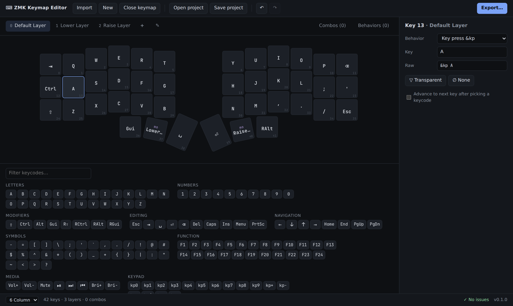

# zmk-yakme

**Yet Another Keymap Editor** for [ZMK](https://zmk.dev) keyboards. Import your physical layout and
keymap, edit layers, keys, combos and behaviors, and download a `.keymap` file for your zmk-config.
It runs entirely in your browser: no install, no account, no firmware changes.

**[Open the editor →](https://ulkden.github.io/zmk-yakme/)**



## What it does

1. **Import** a physical layout (ZMK `.dtsi` / `.overlay`, QMK `info.json` or KLE JSON) and your existing
   `.keymap`, from files, drag and drop, pasted text, or a GitHub file or repository URL.
2. **Edit** keys (palette, behavior picker or just type a letter), layers, combos, and custom hold-tap,
   mod-morph and macro behaviors, with undo/redo and warnings for things that won't work.
3. **Export** a `.keymap`. The layers and combos are written out neatly, optionally with a diagram of
   each layer as a comment (comments inside those two sections are replaced), and behaviors you edited
   are rewritten. Everything else in your file (`#include`s, `#define`s, other comments, unedited
   behaviors and other settings) stays as it was, and missing `#include`s are added for you.

Your work autosaves in the browser, and **Save project** keeps a backup file you can open later.

## Privacy

Nothing you import leaves your browser. There are no analytics, cookies, trackers, external fonts or
CDNs. The only network requests are the ones you ask for, when you import from a GitHub URL, and they
go to GitHub only. A Content-Security-Policy in the page enforces this. Autosave uses your browser's
local storage; **Close keymap** clears it.

## How it compares

There are good tools for ZMK keymaps already. Pick the one that fits how you work:

- **[ZMK Studio](https://zmk.dev/docs/features/studio)** changes the keymap *live on your keyboard*, with no
  reflashing. It needs firmware built with Studio support, and Chrome/Edge or the native app. Combos,
  macros and behavior settings are still on its roadmap. Use it if your board supports it and you want
  changes without a build.
- **[keymap-editor](https://github.com/nickcoutsos/keymap-editor)** by Nick Coutsos is the long-standing and
  most feature-complete visual editor: it can commit straight to your zmk-config on GitHub, and it handles
  conditional layers, encoders and parameterized macros. Its author notes that newer changes to its
  source aren't published.
- **zmk-yakme** works on your files. It needs no GitHub login or repository access and never writes to
  your repo: you download the `.keymap` and commit it yourself. It reads physical layouts directly
  (like [zmk-layout-helper](https://zmk-layout-helper.netlify.app/)) and keeps the rest of your file
  as it was.

What zmk-yakme doesn't do (yet): edit tap-dances, conditional layers, encoders or backlight (they're kept
as they are in your file), open keymaps written with ZMK's helper macros (`ZMK_LAYER`, …), or build and
flash firmware.

## Usage cheatsheet

| Do this | How |
|---|---|
| Import | **Import** → *Choose files…*, paste text, or paste a URL. A GitHub repo URL lists its files so you can pick which to import. You can also drop files anywhere. |
| Edit a key | Click the key, then click a keycode in the palette, choose a behavior in the side panel, or just type a letter or digit. |
| Clear a key | Select it and press <kbd>Delete</kbd>, or use *Transparent* / *None*. |
| Move between keys | Arrow keys (they follow the physical layout) |
| Layers | `+` adds a layer. ✎ (or double-click the active tab) opens layer settings: display name, node name, move, delete. |
| Combos | **Combos** tab → **+ New combo**, then click keys. Set the binding, timeout, prior-idle, slow-release and layers in the side panel. |
| Behaviors | **Behaviors** tab → add a hold-tap, mod-morph or macro, then pick it from the Behavior list when editing a key. |
| Export | **Export…** → set the file name, choose whether to add layer diagrams, then **Download** or **Copy**. |
| Back up work | **Save project** / **Open project** (JSON). Work also autosaves in the browser. |
| Start over | **Close keymap** clears the layout, keymap, autosaved copy and undo history. |
| Undo / redo | <kbd>Ctrl</kbd>+<kbd>Z</kbd> / <kbd>Ctrl</kbd>+<kbd>Shift</kbd>+<kbd>Z</kbd> |

## Feedback and contributing

This is a small project, updated once in a while when ZMK changes or people ask.

- **Found a bug or have an idea?** [Open an issue](https://github.com/ulkden/zmk-yakme/issues/new). Please
  include the version shown at the bottom right of the editor and, if you can, the files you imported.
- **Questions and show-and-tell** go in [Discussions](https://github.com/ulkden/zmk-yakme/discussions).
- **Pull requests** are welcome. Every change follows [AGENTS.md](AGENTS.md) (for humans and AI agents
  alike): small PRs, tests first, green CI on Chromium, Firefox and WebKit.
- Security problems: please report privately, see [SECURITY.md](SECURITY.md).

**About AI assistance:** zmk-yakme is developed with [Claude Code](https://claude.com/claude-code). The
maintainer sets the direction, makes the design decisions, tests the app by hand and reviews and merges
every change. Most of the code and docs are written with AI assistance, held to the same rules as any
other contribution: tests for every change, real ZMK files as fixtures, and no unreviewed merges.

## Development

There is no build step and there are no runtime dependencies: plain ES modules, served as they are.

```sh
nvm use                           # Node version from .nvmrc
npm ci
npm run serve                     # http://localhost:8080
npm run check                     # lint + format check + unit tests
npx playwright install chromium
npm run test:e2e                  # browser tests on Chromium (starts its own server)
npm run test:e2e:all              # Chromium, Firefox and WebKit (as CI does)
# unit tests also run in a browser: http://localhost:8080/tests/
```

CI runs all of the above on every pull request; `main` only accepts changes through a PR with green checks.
Functions stay under 100 lines; a longer one needs an inline reason that lint checks (see
[AGENTS.md](AGENTS.md#code-style)).

**Real ZMK files:** the unit tests import, export and re-import nine real boards from ZMK, pinned in
`tests/fixtures/zmk/`. Once a month, `.github/workflows/zmk-drift.yml` runs the same checks against
ZMK's latest `main` and also sweeps every keymap, physical layout and built-in behavior there. If ZMK
has changed in a way the editor doesn't handle, it opens an issue labelled `zmk-drift` (or comments on the
open one). Run it locally with `npm run zmk-drift -- <path-to-zmk-checkout>`.

**Deploy:** every merge to `main` runs the full CI suite and then publishes to GitHub Pages
(`.github/workflows/deploy.yml`). `npm run build` assembles the site in `_site/`: only the app files,
with a version stamp (`?v=<version>+<commit>`) on every module, stylesheet and font URL, so browsers
don't mix cached old files with new ones after a deploy. `npm run test:site` builds and smoke-tests it.

**Releases:** the app shows its version in the status bar and on the welcome screen, linking to that
release's notes. See [CHANGELOG.md](CHANGELOG.md) for what changed, and
[GitHub Releases](https://github.com/ulkden/zmk-yakme/releases) for every merged pull request. How to cut a
release is described in [AGENTS.md](AGENTS.md#releases).

More: [docs/DESIGN.md](docs/DESIGN.md) (functional design), [ASSUMPTIONS.md](ASSUMPTIONS.md) (design
decisions), [docs/QA.md](docs/QA.md) (manual QA process).

## Credits and license

Inspired by [keymap-editor](https://github.com/nickcoutsos/keymap-editor) by Nick Coutsos and
[zmk-layout-helper](https://zmk-layout-helper.netlify.app/). No code was copied from either project.
The test fixtures in `tests/fixtures/zmk/` are real files from [ZMK](https://github.com/zmkfirmware/zmk),
© The ZMK Contributors, used under the MIT License.

This project is released under the [MIT License](LICENSE). The bundled JetBrains Mono font is under the
[SIL Open Font License 1.1](fonts/OFL.txt).
