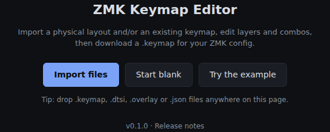
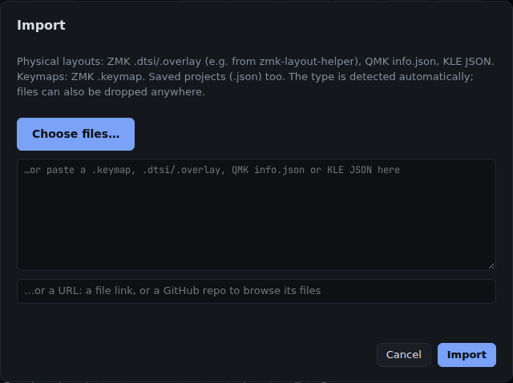
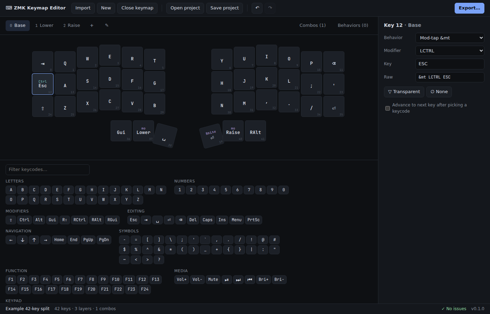
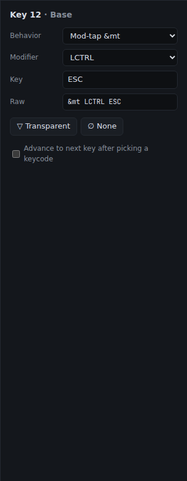
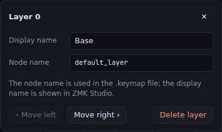
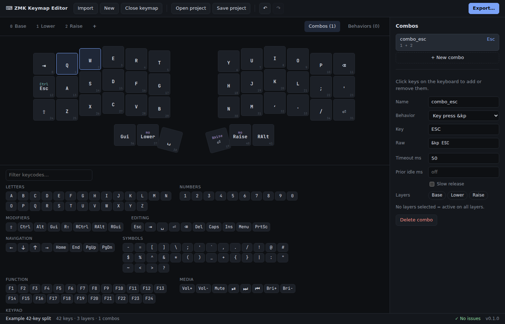
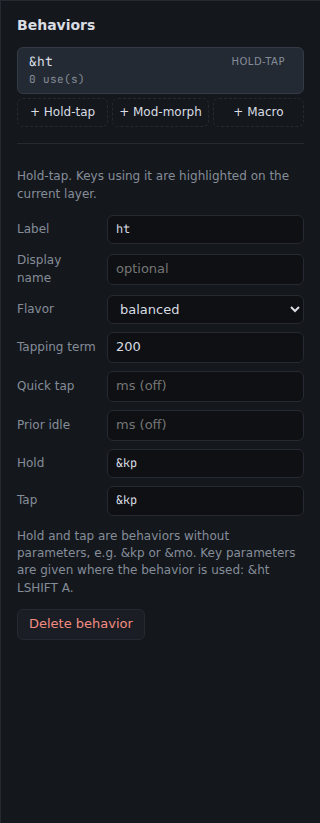
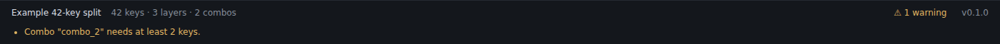
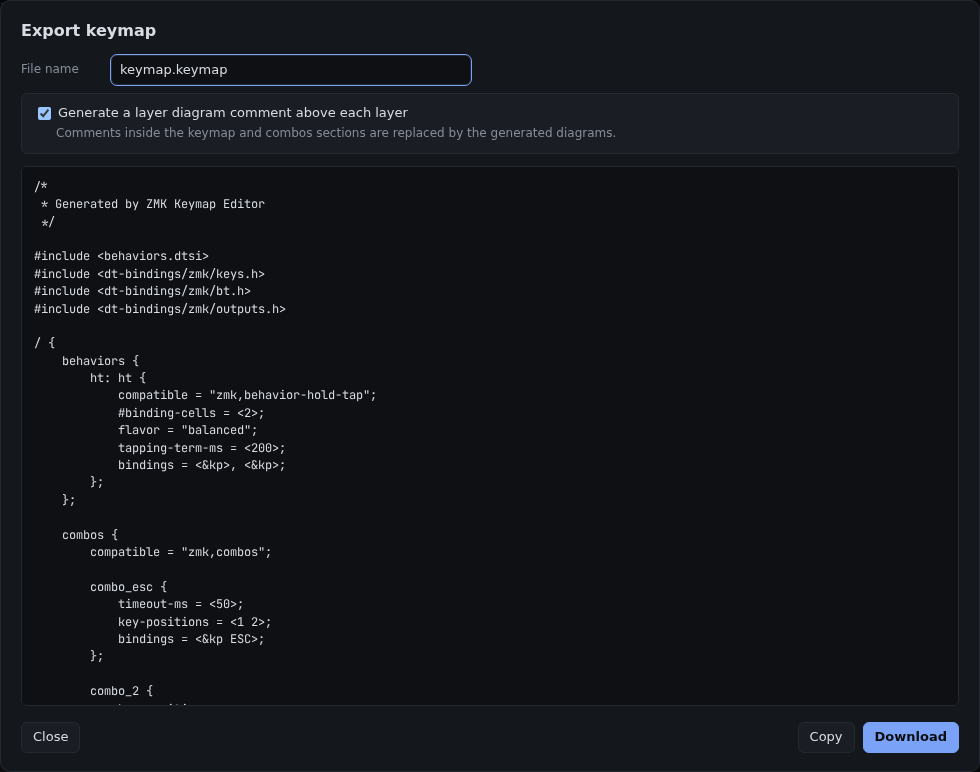

# zmk-yakme user guide

zmk-yakme edits [ZMK](https://zmk.dev) keymaps in your browser: import your keyboard's layout and
keymap, change keys, layers, combos and behaviors, and export a `.keymap` for your zmk-config.
Open it at <https://ulkden.github.io/zmk-yakme/>. Nothing you load leaves your browser.

**Contents:** [Getting started](#getting-started) · [Importing](#importing) ·
[Editing keys](#editing-keys) · [Layers](#layers) · [Combos](#combos) · [Behaviors](#behaviors) ·
[Checking your work](#checking-your-work) · [Exporting](#exporting) ·
[Saving your work](#saving-your-work) · [Shortcuts cheat sheet](#shortcuts-cheat-sheet)

Sections are added as each feature passes [manual QA](../QA.md). Importing from a GitHub repository,
advanced combo options, renaming and deleting behaviors, and added `#include`s are still in QA.

## Getting started

### Try the example

1. Open the app. The welcome screen offers **Import Files**, **Start Blank**, **Try the Example** and
   **Open Project**.
2. Click **Try the Example**: a 42-key split keyboard with Base, Lower and Raise layers.
3. Reload the page whenever you like. Your work is saved in the browser.

### Start a blank keymap

1. Click **New** in the toolbar (or **Start Blank** on the welcome screen).
2. Enter the keys per row, e.g. `10, 10, 10`, and the number of layers.
3. Click **Create Grid**. If a layout is already loaded, **Blank on Current Layout** keeps it.

### Version and release notes

The version is shown on the welcome screen and at the right of the status bar. Click it to read that
version's release notes.

## Importing

### Import your keyboard

1. Click **Import** → **Choose Files…**.
2. Select your physical layout (a ZMK `.dtsi` or `.overlay`, e.g. from a shield's `-layouts.dtsi` or
   zmk-layout-helper) and your `.keymap` **together**.
3. Check the layer tabs, and the **Combos** and **Behaviors** tabs.

- Layouts from every file are offered under **Physical Layouts** in the status bar. The one whose key
  count matches the keymap is selected; switch any time.
- A keymap without a layout is shown on an "Inferred grid" built from the file's rows. Import the
  layout later: it replaces the grid and keeps the keymap.
- A layout without a keymap gets an empty keymap.

### Other ways to import

- **Drag and drop:** drop layout and keymap files anywhere on the page.
- **Paste a GitHub link** to a single file (github.com, raw.githubusercontent.com or a gist) into the
  URL field, then click **Load**. Links to other sites are refused.
- **Paste text:** paste a file's contents into the text box, then click **Load**.
- **QMK and KLE layouts:** paste a QMK `info.json` or keyboard-layout-editor.com **Raw data**. With no
  keymap loaded, KLE legends become the starting keys (`Q` → Q, `Shift` → ⇧).

### When a file can't be imported

The dialog says why, e.g. "No physical layout or keymap found". Keymaps written with ZMK helper macros
(`ZMK_LAYER(...)`) aren't supported yet. Use **Open an issue on GitHub** to ask for them.

## Editing keys

### Select keys

- Click a key to select it. The side panel shows its number and layer.
- Arrow keys move to the physically nearest key, following stagger and thumb clusters.
- Click the selected key again, or press <kbd>Esc</kbd>, to deselect.

### Assign a keycode

1. Select a key.
2. Click a keycode in the palette below the keyboard, or simply type a letter or digit.

- Type in **Filter keycodes…** to narrow the palette (e.g. `vol`). The ✕ or <kbd>Esc</kbd> clears it.
- On a mod-tap or layer-tap key, a keycode sets the **tap** key and keeps the modifier or layer.
- Tick **Advance to next key after picking a keycode** to fill a layer quickly. The setting is
  remembered.

### Choose a behavior and its parameters

1. Select a key.
2. Pick a **Behavior** in the side panel (key press, mod-tap, layer-tap, layers, Bluetooth, output,
   RGB, mouse…).
3. Fill in its parameters. Layer choices list your layer names.

- **Raw** always matches the fields: edit Raw (e.g. `&lt 1 TAB`) and the Behavior and parameters update
  to match; change a field and Raw is rewritten.
- Behaviors defined in your keymap are listed under **From keymap**.

### Clear keys

- Press <kbd>Delete</kbd> (or <kbd>Backspace</kbd>): `&none` on layer 0, `&trans` on other layers.
- Or click **▽ Transparent** (the layer below shows through, drawn as a dim ▽) or **∅ None** (blank).

## Layers

- **Add:** click **+** after the layer tabs. The new layer is fully transparent and selected.
- **Switch:** click a tab. Each shows its number and name.
- **Settings:** click ✎, or double-click the active tab.
  - **Display name** is shown in ZMK Studio; **Node name** is used in the `.keymap` (e.g. `Nav Layer!`
    becomes `nav_layer`).
  - **‹ Move Left** / **Move Right ›** reorder layers. Layer references (`&mo`, `&lt`, `&to`, `&tog`,
    `&sl` and combo layers) are renumbered for you.
  - **Delete Layer** asks inside the panel first. References to the deleted layer become `&trans`.
  - If your file uses named references such as `&mo NAV`, a warning reminds you to check your
    `#define`s after moving or deleting.
- Close the panel with ✕, <kbd>Esc</kbd> or a click outside. <kbd>Ctrl</kbd>+<kbd>Z</kbd> undoes any of it.

## Combos

A combo makes keys pressed together send something else.

1. Open the **Combos** tab and click **+ New Combo**.
2. Click two or more keys on the keyboard. They're highlighted, and listed as small keycaps.
3. Set the output: click a keycode in the palette, or choose a behavior in the side panel.
4. Optionally set **Timeout ms** (e.g. `40`) and pick **Layers**. No layers selected = all layers.
5. Click **Save Combo** (or press <kbd>Esc</kbd>) to finish. **Delete Combo** removes it.

Key clicks only change a combo while one is selected.

## Behaviors

Custom behaviors are defined once in the **Behaviors** tab and then used on any key. Changes apply as
you make them; **Save Behavior** takes you back to the key you were editing.

### Home-row mods (hold-tap)

A hold-tap does one thing when tapped and another when held.

1. Select the key you want to change, e.g. A on Base.
2. Open **Behaviors** and click **+ Hold-Tap**.
3. Set **Label** to `hm`, pick a **Flavor** (e.g. tap-preferred) and a **Tapping term** (e.g. `200`).
   Leave **Hold** and **Tap** as `&kp`.
4. Click **Save Behavior**. You're back on your key.
5. Choose **hm** under **From keymap** in the Behavior list, then enter `LSHIFT` and `A`.

The key shows A with ⇧ above it. The Behaviors list shows how many keys use `&hm`, and those keys are
highlighted while the behavior is selected.

### Mod-morph

A mod-morph sends one binding normally and another while chosen modifiers are held.

1. Click **+ Mod-Morph**.
2. Set **Normal** to `&kp COMMA` and **With mods** to `&kp SEMI`; pick **LShift** under **Mods**.
3. Use it on a key: choose it in the Behavior list, or type `&mm` in **Raw**.

### Macro

A macro sends a sequence of keys from one key press.

1. Click **+ Macro**.
2. Enter the steps one per line: `&macro_tap`, `&kp H`, `&kp I`.
3. Optionally set **Wait** and **Tap** times. They're written only when set.
4. Use `&macro` on a key.

## Checking your work

- The **status bar** shows the layout, key, layer and combo counts.
- Problems, such as a layer with more bindings than the layout has keys, appear as **⚠ N warnings**. New
  warnings pulse once.
  - Click it for the list. Some warnings offer a fix, e.g. **Trim Extra Bindings** (undoable).
  - **Clear Warnings** hides the current ones until something new comes up; **N hidden** shows them again.
- **Undo / redo:** <kbd>Ctrl</kbd>+<kbd>Z</kbd> / <kbd>Ctrl</kbd>+<kbd>Shift</kbd>+<kbd>Z</kbd>, or
  ↶ and ↷ in the toolbar. Every edit can be undone.

## Exporting

1. Click **Export…**. Opening it changes nothing.
2. Check the file name; it always ends in `.keymap` and is remembered.
3. Click **Copy** or **Download**. Both match the preview.

- **Layer diagrams:** export can add an ASCII drawing of each layer above it, in your board's shape.
  Untick the option to leave them out; the choice is remembered.
- **What export changes in an imported file:** the layers and combos sections are written out neatly
  (comments inside them are replaced), and behaviors you edited are rewritten. Everything else stays as
  it was: `#include`s, `#define`s, other comments, unedited behaviors and other settings.
- Replace the `.keymap` in your zmk-config with the download, review the diff, and push to build.

## Saving your work

- **Autosave:** your work, layout choice and file name are kept in the browser and restored when you
  come back.
- **Save Project** downloads `<name>.zmk-project.json` with the layouts, keymap and file name.
  **Open Project** (toolbar or welcome screen) restores it, also in another browser or computer.
- **Replacing work asks first:** starting over or importing a keymap when you have changes that weren't
  exported or saved asks before replacing them. <kbd>Ctrl</kbd>+<kbd>Z</kbd> brings replaced work back
  until you reload.
- **Close Keymap** returns to a fresh welcome screen: no layout, keymap, autosaved copy or undo history.
  Tick **Also reset preferences** to also forget auto-advance and layer diagrams.

## Shortcuts cheat sheet

| Do this | How |
|---|---|
| Move between keys | Arrow keys (follow the physical layout) |
| Assign a letter or digit | Select a key and type it (digits become `N1`…) |
| Clear a key | <kbd>Delete</kbd> or <kbd>Backspace</kbd>: `&none` on layer 0, `&trans` elsewhere |
| Deselect a key | <kbd>Esc</kbd>, or click it again |
| Finish a combo | <kbd>Esc</kbd> or **Save Combo** |
| Undo / redo | <kbd>Ctrl</kbd>+<kbd>Z</kbd> / <kbd>Ctrl</kbd>+<kbd>Shift</kbd>+<kbd>Z</kbd> (or <kbd>Ctrl</kbd>+<kbd>Y</kbd>) |
| Layer settings | Double-click the active layer tab |
| Change a number | Click the field, then scroll: ±10 for milliseconds (<kbd>Shift</kbd> for ±1) |
| Clear the keycode filter | <kbd>Esc</kbd> in the filter, or its ✕ |
| Close any dialog or panel | <kbd>Esc</kbd>, its ✕, or a click outside |
| Import | Drop files anywhere on the page |

On macOS, use <kbd>⌘</kbd> instead of <kbd>Ctrl</kbd>.
